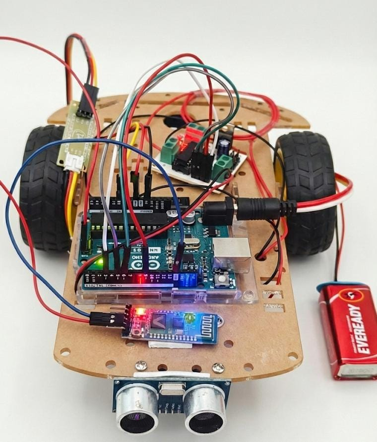
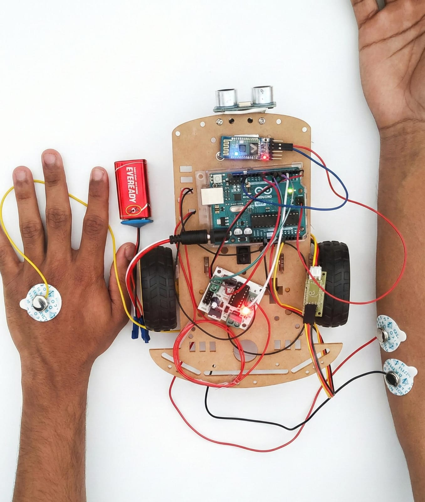

# Smart Wheelchair with Voice & EMG Control

A prototype smart wheelchair system using Arduino,
Bluetooth voice commands, and EMG-based muscle control.

## Team Members
- Akshay Bhat  
- Amogh Basavaraj
- Manas Prashant

## Features
- Voice control via Bluetooth Serial (HC-05)
- EMG control using BioAmp Candy (Upside Down Labs)
- Signal filtering, envelope detection, and debouncing
- Safety-based state-based motor control
- Obstacle awareness using ultrasonic sensor
- Real-time command execution

## Hardware Used
- Arduino Uno  
- HC-05 Bluetooth Module  
- BioAmp Candy EMG Sensor (Upside Down Labs)
- Gel electrodes
- Ultrasonic Sensor (HC-SR04)  
- Motor Driver Module  
- DC Gear Motors  
- Robot Chassis with Wheels  
- Battery / Power Supply  
- Jumper Wires  
- Resistors (for voltage divider)  
- Breadboard / PCB (if used)

## Images

## License
MIT
